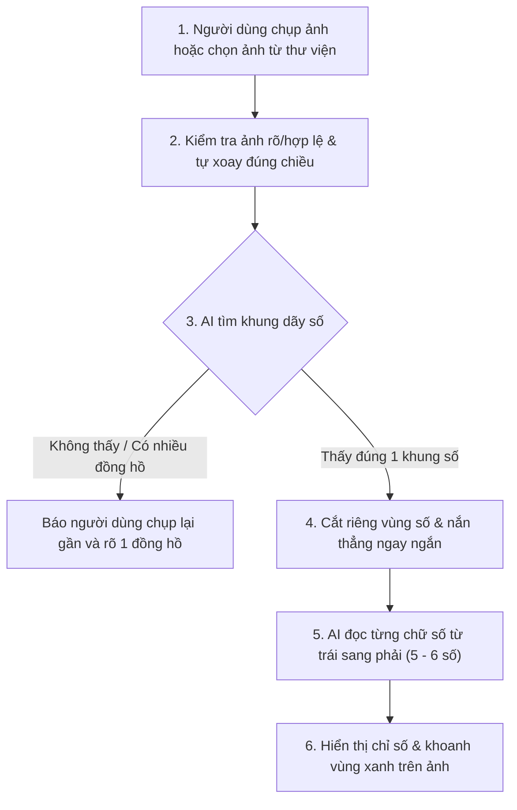
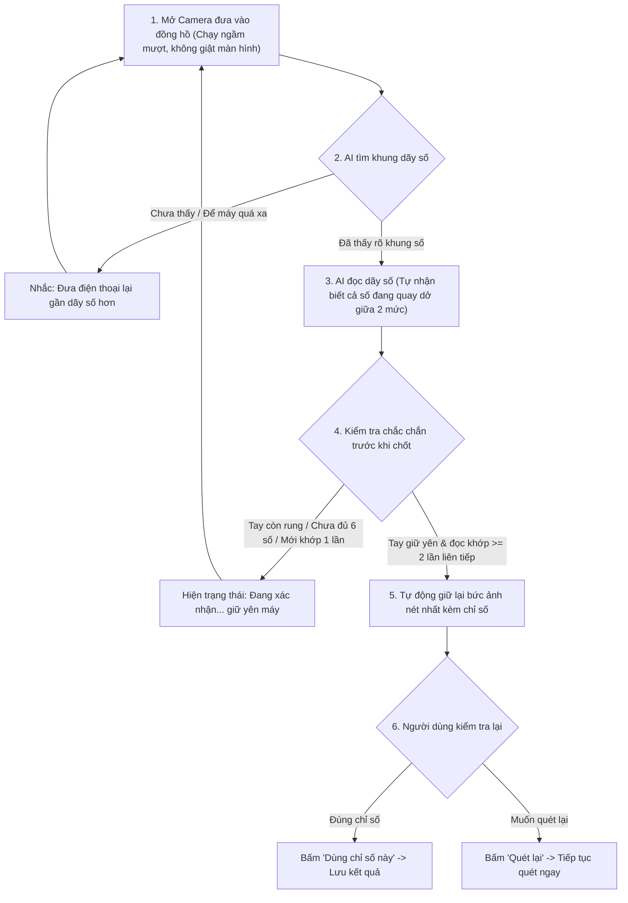

# Luồng hoạt động & Kiến trúc OCR Đồng hồ nước

Ứng dụng đọc chỉ số đồng hồ nước hoạt động **100% offline ngay trên điện thoại** (không cần mạng Internet). Hệ thống AI đọc số theo 3 bước tự nhiên giống mắt người: **Tìm khung mặt số → Cắt phẳng ngay ngắn → Đọc từng chữ số từ trái sang phải**.

---

## 1. Luồng đọc từ Ảnh chụp / Thư viện

Dành cho trường hợp người dùng chụp một bức ảnh hoặc chọn ảnh có sẵn trong máy:

---

## 2. Luồng quét Camera Realtime (Tự động bắt số)

Dành cho trường hợp người dùng mở camera đưa vào đồng hồ để máy tự động nhận diện và chốt ảnh:

### Vì sao luồng Realtime hoạt động ổn định?
- **Không chốt vội khi tay còn di chuyển:** Máy chỉ tự dừng ảnh khi bạn giữ yên điện thoại và AI đọc ra **cùng một dãy số ít nhất 2 lần liên tiếp**.
- **Không đọc thiếu chữ số (5 số thay vì 6 số):** Máy kiểm tra khoảng cách đều nhau giữa các chữ số; nếu đã nhìn thấy đồng hồ 6 số thì sẽ bỏ qua các khung hình bị lóa/mất 1 số.
- **Xử lý được đồng hồ đang nhảy số (cắt nửa giữa 4 và 5):** Khi vòng quay cơ học nằm lưng chừng giữa 2 số, AI tự gộp tín hiệu ở vị trí đó để đọc ra chữ số hợp lý nhất thay vì bỏ trống.
- **Màn hình luôn mượt khi lia máy:** Việc phân tích AI chạy hoàn toàn ở luồng nền và chỉ lấy khung hình mới nhất, không làm đơ hay chớp đen màn hình camera.

---

## 3. Bản đồ mã nguồn (Dành cho kỹ thuật)

| Thành phần | Vai trò | File sở hữu |
|---|---|---|
| **Màn hình chính** | Chọn ảnh, chụp ảnh, mở quét realtime và hiển thị kết quả | [`MeterScreen.tsx`](../app/src/screens/MeterScreen.tsx), [`result.ts`](../app/src/ocr/result.ts) |
| **Cầu nối React Native ↔ Android** | Hợp đồng giao tiếp giữa giao diện JS và nhân xử lý Kotlin | [`NativeMeterOcr.ts`](../app/src/specs/NativeMeterOcr.ts), [`MeterOcrModule.kt`](../app/android/app/src/main/java/com/watermeterocr/ocr/MeterOcrModule.kt) |
| **Màn hình Camera Realtime** | Điều khiển CameraX, luồng nền `worker`, giao diện giữ ảnh | [`RealtimeMeterActivity.kt`](../app/android/app/src/main/java/com/watermeterocr/ocr/RealtimeMeterActivity.kt), [`AnalysisCadence.kt`](../app/android/app/src/main/java/com/watermeterocr/ocr/AnalysisCadence.kt) |
| **Bộ lọc chất lượng & độ ổn định** | Kiểm tra độ nét, bố cục đủ số và đối chiếu nhiều khung hình liên tiếp | [`ReadingQuality.kt`](../app/android/app/src/main/java/com/watermeterocr/ocr/ReadingQuality.kt), [`ReadingStability.kt`](../app/android/app/src/main/java/com/watermeterocr/ocr/ReadingStability.kt) |
| **Nhân AI 3 bước (ONNX + OpenCV)** | Tìm khung (`frame.onnx`), kiểm tra ngược (`reverse.onnx`), đọc số (`digits.onnx`) | [`SuppliedYoloEngine.kt`](../app/android/app/src/main/java/com/watermeterocr/ocr/SuppliedYoloEngine.kt), [`SuppliedYoloDecoder.kt`](../app/android/app/src/main/java/com/watermeterocr/ocr/SuppliedYoloDecoder.kt) |
| **Cấu hình Model & Công cụ xuất** | Thông số model ONNX và script chuyển đổi từ PyTorch `.pt` | [`supplied-yolo-manifest.json`](../app/android/app/src/main/assets/ocr/supplied-yolo-manifest.json), [`tools/ocr/README.md`](../tools/ocr/README.md) |
