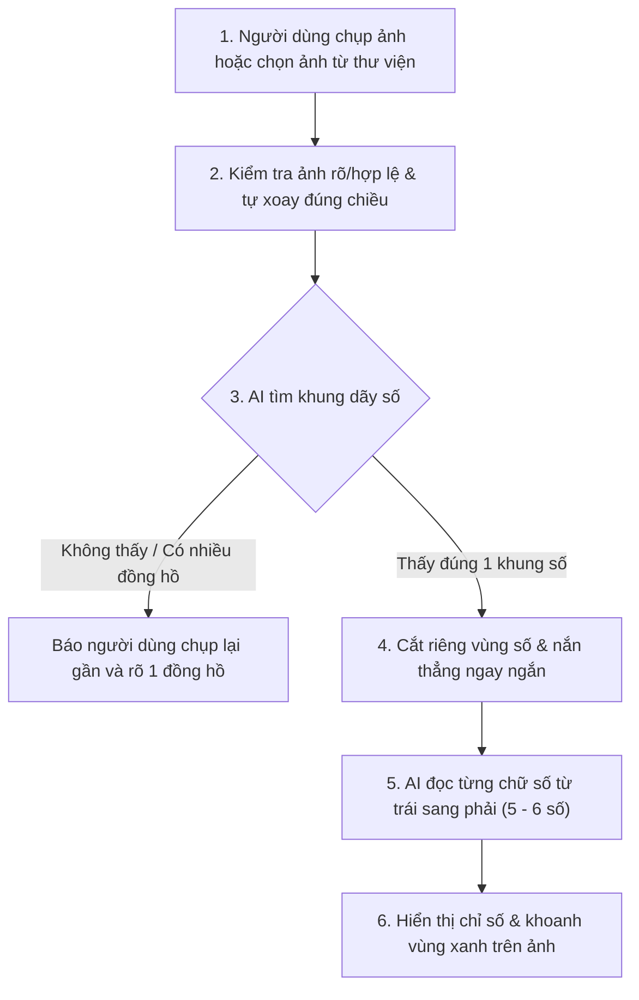
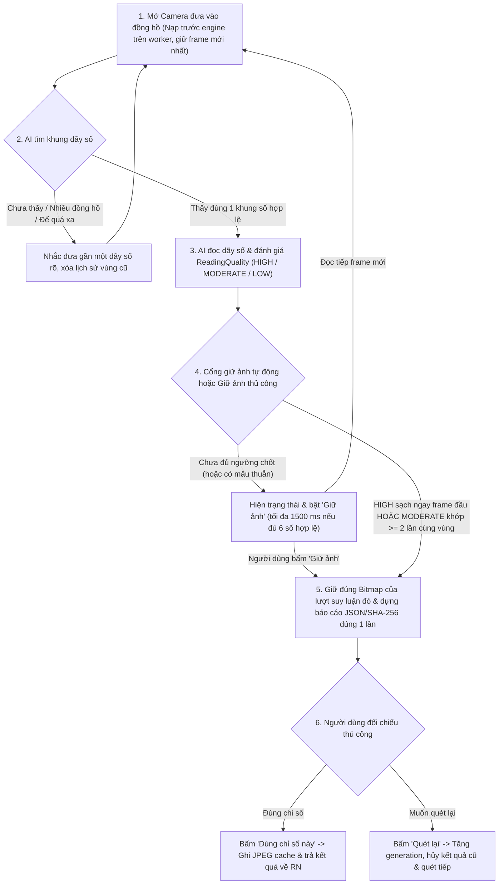

# Luồng hoạt động & Kiến trúc OCR Đồng hồ nước

Ứng dụng đọc chỉ số đồng hồ nước hoạt động **100% offline ngay trên điện thoại** (không cần mạng Internet). Hệ thống AI đọc số theo 3 bước tự nhiên giống mắt người: **Tìm khung mặt số → Cắt phẳng ngay ngắn → Đọc từng chữ số từ trái sang phải**.

---

## 1. Luồng đọc từ Ảnh chụp / Thư viện

Dành cho trường hợp người dùng chụp một bức ảnh hoặc chọn ảnh có sẵn trong máy:

---

## 2. Luồng quét Camera Realtime (Tự động bắt số & Giữ ảnh chủ động)

Dành cho trường hợp người dùng mở camera đưa vào đồng hồ để máy tự động nhận diện hoặc chủ động bấm giữ ảnh:

### Quy tắc cổng chất lượng, nhịp phân tích và giới hạn nghiệm thu
- **Giữ ngay frame chất lượng cao (`HIGH`), đối chiếu theo cặp ở mức vừa (`MODERATE`):**
  - `HIGH` (chữ số yếu nhất `>= 0.90`, trung bình `>= 0.95`, điểm khung `>= 0.85`, không có lớp chuyển tiếp `>= 10`, polygon gốc trước clamp nằm trong ảnh với dung sai `0.5 px`) tự giữ ngay ở quan sát đầu tiên nếu không có chuỗi hợp lệ mâu thuẫn trước đó.
  - `MODERATE` (chữ số `>= 0.65`, trung bình `>= 0.80`, khung `>= 0.60`, hoặc chữ số cuối đang chuyển tiếp hợp lệ) cần **2 quan sát trùng khớp** trên cùng vùng mục tiêu (IoU `>= 0.55` với vùng neo và `>= 0.65` với frame liền trước) trong cửa sổ thích ứng `clamp(3 * EWMA, 3000, 10000) ms` mà không ép chờ cố định 800 ms. Nếu lịch sử trong 5 mẫu gần nhất có chuỗi khác nhau, hệ thống yêu cầu xác nhận lại liên tiếp/đa số trước khi chốt.
  - `LOW` và `INVALID` không bao giờ tự chốt. Một frame `LOW` có cùng vùng hợp lệ chỉ bảo toàn ứng viên tối đa `1200 ms` qua nhịp mờ ngắn mà không cộng phiếu; mất vùng, nhiều vùng, lệch mục tiêu, hình học lỗi, timestamp camera trùng/lùi hoặc đổi `generation` (pause/reset/đóng) đều xóa sạch lịch sử.
- **Giữ ảnh thủ công (`Giữ ảnh`) và xác nhận thủ công (`Dùng chỉ số này`):**
  - Khi frame mới nhất đạt `status = "ok"` với đủ 6 chữ số và hình học hợp lệ (kể cả mức `LOW`/`MODERATE`), nút **Giữ ảnh** được bật tối đa `1500 ms` trên luồng chính để người dùng chủ động giữ ngay ảnh đang hiển thị.
  - Cả tự động giữ lẫn **Giữ ảnh** đều không tự gửi chỉ số hay ghi JPEG sớm. Chỉ khi người dùng bấm **Dùng chỉ số này**, ứng dụng mới nén đúng `Bitmap` đang giữ thành JPEG trong `cacheDir` và trả `{uri, width, height, size, result}` (`source = "realtime"`).
- **Không đọc thiếu chữ số & xử lý vòng quay đang nhảy:** Kiểm tra bước nhảy ngang/cao độ giữa các ký tự; nếu đã thấy mặt đồng hồ 6 số thì chặn kết quả 5 số bị khuyết, đồng thời gộp tín hiệu khi vòng quay cơ học nằm lưng chừng giữa 2 số (không tự bịa hay đệm số `0` đầu bị model bỏ sót).
- **Đường chạy nền nhẹ và nhịp thích ứng:** `SuppliedYoloEngine` được khởi tạo sớm trên `worker` trước khi gắn analyzer (`STRATEGY_KEEP_ONLY_LATEST`). Nhịp bắt đầu phân tích thích ứng theo EWMA thời gian xử lý thực tế (`khởi đầu 200 ms`, `clamp(1.25 * EWMA, 150, 400) ms`, `alpha = 0.25`). Các frame bị bỏ qua chỉ giữ dữ liệu nhẹ `RealtimeFrame`; báo cáo JSON chi tiết và mã băm pixel SHA-256 chỉ được tính một lần cho frame được giữ mà không chạy lại model.
- **Lưu ý độ chính xác thực địa:** Ngưỡng điểm hiện tại là cấu hình khởi tạo bảo thủ, chưa phải xác suất đúng đã hiệu chỉnh. Một frame điểm cao hoặc 5 chữ số hợp lệ vẫn có thể đọc sai trên cảnh lóa/mờ thực tế, nên bước đối chiếu thủ công luôn được giữ và việc hiệu chỉnh ngưỡng/độ trễ cần đo trên bộ mẫu camera có nhãn chuẩn.

---

## 3. Bản đồ mã nguồn (Dành cho kỹ thuật)

| Thành phần | Vai trò | File sở hữu |
|---|---|---|
| **Màn hình chính** | Chọn ảnh, chụp ảnh, mở quét realtime và hiển thị kết quả | [`MeterScreen.tsx`](../app/src/screens/MeterScreen.tsx), [`result.ts`](../app/src/ocr/result.ts) |
| **Cầu nối React Native ↔ Android** | Hợp đồng giao tiếp giữa giao diện JS và nhân xử lý Kotlin | [`NativeMeterOcr.ts`](../app/src/specs/NativeMeterOcr.ts), [`MeterOcrModule.kt`](../app/android/app/src/main/java/com/watermeterocr/ocr/MeterOcrModule.kt) |
| **Màn hình Camera Realtime** | Điều khiển CameraX, luồng nền `worker`, giao diện giữ ảnh | [`RealtimeMeterActivity.kt`](../app/android/app/src/main/java/com/watermeterocr/ocr/RealtimeMeterActivity.kt), [`AnalysisCadence.kt`](../app/android/app/src/main/java/com/watermeterocr/ocr/AnalysisCadence.kt) |
| **Bộ lọc chất lượng & độ ổn định** | Kiểm tra độ nét, bố cục đủ số và đối chiếu nhiều khung hình liên tiếp | [`ReadingQuality.kt`](../app/android/app/src/main/java/com/watermeterocr/ocr/ReadingQuality.kt), [`ReadingStability.kt`](../app/android/app/src/main/java/com/watermeterocr/ocr/ReadingStability.kt) |
| **Nhân AI 3 bước (ONNX + OpenCV)** | Tìm khung (`frame.onnx`), kiểm tra ngược (`reverse.onnx`), đọc số (`digits.onnx`) | [`SuppliedYoloEngine.kt`](../app/android/app/src/main/java/com/watermeterocr/ocr/SuppliedYoloEngine.kt), [`SuppliedYoloDecoder.kt`](../app/android/app/src/main/java/com/watermeterocr/ocr/SuppliedYoloDecoder.kt) |
| **Cấu hình Model & Công cụ xuất** | Thông số model ONNX và script chuyển đổi từ PyTorch `.pt` | [`supplied-yolo-manifest.json`](../app/android/app/src/main/assets/ocr/supplied-yolo-manifest.json), [`tools/ocr/README.md`](../tools/ocr/README.md) |
